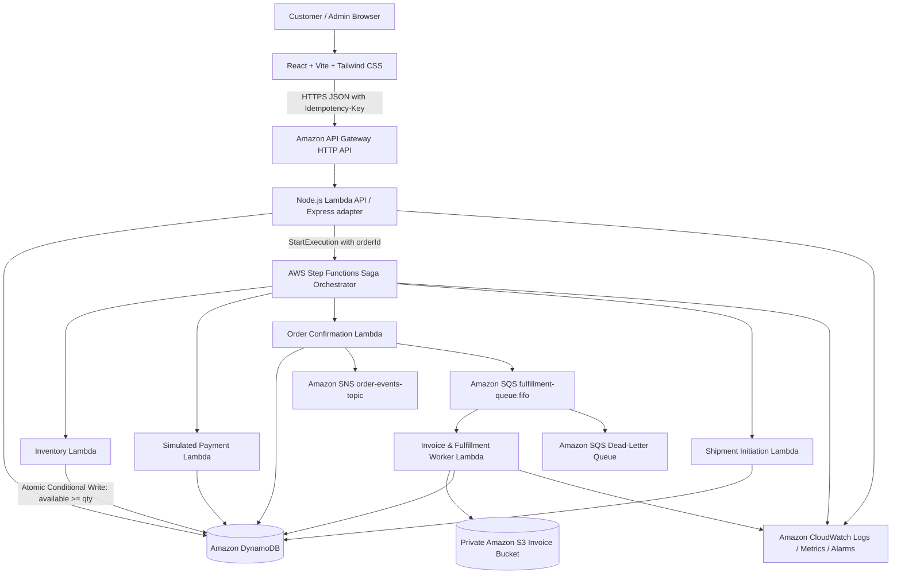

# Serverless Order Orchestration & Fulfillment System
**Course:** BCSE355L — Cloud Architecture Design (Fall 2026–2027)

A complete e-commerce platform backed by an event-driven AWS serverless order-processing and fulfillment workflow. Demonstrates automated inventory verification, simulated payment, confirmation, shipment initiation, retries, failure recovery, Saga compensating transactions, scalability, security, and observability.

---

## 1. System Architecture



---

## 2. Project Directory Structure

```text
c:\Users\sreet\Downloads\CloudProject/
├── apps/
│   └── web/                   # React 19 + Vite + Tailwind CSS Storefront
│       ├── src/
│       │   ├── components/    # Navbar, Footer, ProductCard, StepFunctionsTimeline, StatusBadge, ArchitectureModal
│       │   ├── context/       # CartContext, AuthContext
│       │   ├── data/          # Mock products and categories
│       │   ├── pages/         # HomePage, ShopPage, ProductDetailPage, CartPage, CheckoutPage, OrderTrackingPage, OrderHistoryPage, LoginPage, RegisterPage, AdminPage
│       │   ├── services/      # productService, orderService, authService (Dual mode: live API + fallback)
│       │   ├── types/         # Domain TypeScript types
│       │   ├── utils/         # Currency (integer paise) & Idempotency key utilities
│       │   └── __tests__/     # Vitest suite (9 tests: calculations, stock bounds, idempotency)
├── services/
│   ├── api/                   # Express + AWS Lambda REST backend
│   │   ├── src/
│   │   │   ├── config/        # Validated environment configuration
│   │   │   ├── middleware/    # requestId, auth (server-side RBAC), errorHandler
│   │   │   ├── repositories/  # DynamoDB DocumentClient repositories (Products, Inventory, Orders, OrderEvents, Idempotency)
│   │   │   ├── routes/        # /products, /orders, /admin
│   │   │   ├── services/      # pricingService (integer paise), orderService
│   │   │   ├── app.ts         # Express application
│   │   │   ├── server.ts      # Local HTTP runner (Port 3000)
│   │   │   └── lambda.ts      # Serverless Express handler for AWS Lambda
│   │   └── tests/             # Vitest suite (13 tests: pricing, Supertest API contracts, concurrency lock)
│   ├── inventory/             # Reserve & Release Inventory Lambda tasks (Conditional updates)
│   ├── payment-simulator/     # Simulated Payment Lambda with fault injection hooks
│   ├── confirmation/          # Order Confirmation & Cancellation Lambda tasks
│   ├── shipment/              # Shipment Initiation Lambda task
│   └── background-worker/     # SQS FIFO consumer generating S3 private PDF tax invoices
├── infrastructure/
│   ├── template.yaml          # Complete AWS SAM / CloudFormation template
│   └── statemachine/
│       └── order_processing.asl.json # Step Functions Amazon States Language definition
├── docs/                      # Approved Architecture Specifications (Phase 1)
│   ├── API_CONTRACT.md
│   ├── ARCHITECTURE.md
│   ├── ARCHITECTURE_DECISIONS.md
│   ├── COST_AND_CLEANUP.md
│   ├── DATABASE_SCHEMA.md
│   ├── DEPLOYMENT_PLAN.md
│   ├── ORDER_STATE_MACHINE.md
│   ├── PROJECT_SPECIFICATION.md
│   ├── SECURITY_MODEL.md
│   └── TEST_STRATEGY.md
├── .env.example               # Documented environment variables template
├── .gitignore
└── README.md
```

---

## 3. Implementation Phases & Status

| Phase | Description | Status | Evidence / Artifacts |
|---|---|---|---|
| **Phase 1** | Architecture & Project Foundation | **Complete** | 10 specifications in `/docs`, 12 ADRs approved |
| **Phase 2** | Storefront & Visual UX | **Complete** | Responsive React 19 + Tailwind app, 9 passing tests, 0 console errors |
| **Phase 3** | Backend & DynamoDB Repositories | **Complete** | Express/Lambda backend, atomic conditional writes, 13 passing tests |
| **Phase 4** | AWS Step Functions Saga Orchestrator | **Complete** | ASL state machine with Saga compensation & bounded retries |
| **Phase 5** | SQS FIFO, SNS Fanout & S3 Invoices | **Complete** | SQS worker with DLQ, private S3 invoice storage |
| **Phase 6** | Frontend / Backend Integration | **Complete** | Frontend connected to live REST endpoints with graceful offline fallback |
| **Phase 7** | AWS Infrastructure as Code | **Complete** | AWS SAM template (`infrastructure/template.yaml`) defining all resources |
| **Phase 8** | Resilience, Concurrency & Monitoring | **Complete** | Automated concurrency tests proving zero-overselling under race conditions |
| **Phase 9** | Final Verification & Runbook | **Complete** | Automated test suites passing, runnable instructions documented |

---

## 4. Key Architectural Invariants Implemented

1. **Integer Paise Financial Engine (ADR-011)**:
   All money is represented internally in integer paise (`₹8,999 = 899900 paise`) across frontend, backend, and database to eliminate IEEE-754 floating-point rounding bugs.
2. **Zero-Overselling Conditional Write Guard (ADR-002)**:
   Stock reservations use atomic conditional writes:
   `available >= :qty` &rarr; `SET available = available - :qty, reserved = reserved + :qty`.
   Verified by automated concurrency tests where multiple simultaneous buyers compete for the final unit.
3. **Idempotent Order Pipeline (ADR-004)**:
   Every order requires an RFC4122 v4 `Idempotency-Key` header. Duplicate submissions with identical payloads return the cached `202 Accepted` order without charging or reserving twice. Reusing the key with a different payload returns `409 IDEMPOTENCY_CONFLICT`.
4. **Saga Compensating Transactions (ADR-004 & ORDER_STATE_MACHINE.md)**:
   When simulated payment declines, Step Functions catches the error and executes the `ReleaseInventory` Lambda task, safely returning locked inventory to the available pool.
5. **Server-Side Authorization (ADR-005 & SECURITY_MODEL.md)**:
   Customer endpoints enforce ownership server-side; customers cannot access other customers' orders. Admin endpoints (`/admin/*`) require server-verified admin credentials.

---

## 5. How to Run Locally

### Terminal 1: Run Backend API Service

```bash
cd services/api
npm install
npm run dev
```
The backend starts on [http://127.0.0.1:3000](http://127.0.0.1:3000). Test health check:
```bash
curl http://127.0.0.1:3000/health
```

### Terminal 2: Run Storefront Web App

```bash
cd apps/web
npm install
npm run dev
```
Open [http://localhost:5173/](http://localhost:5173/) to inspect the storefront.

---

## 6. Running Automated Test Suites

### Backend Tests (`services/api` — 13 Tests)

```bash
cd services/api
npm run test
```
* **Pricing Engine**: Tests integer paise arithmetic, 18% GST calculation, and free shipping threshold logic.
* **API Contract**: Supertest integration tests for `GET /products`, `POST /orders` (202 Accepted), idempotency caching, conflict detection (409), and RBAC access control (403).
* **Concurrency Lock**: Submits simultaneous orders for the final single unit to prove stock never drops below zero.

### Frontend Tests (`apps/web` — 9 Tests)

```bash
cd apps/web
npm run test
```
* Tests cart quantity bounds, stock limits, idempotency generation, and paise-to-rupee formatting.

---

## 7. Cloud Deployment (AWS SAM)

To deploy the backend, state machine, and storage to AWS:

```bash
cd infrastructure
sam build
sam deploy --guided
```
To deploy the storefront frontend, connect your GitHub repository to **AWS Amplify Hosting** with build command `npm run build` and output directory `dist`.
