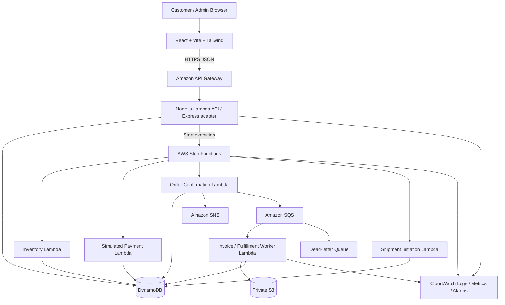

# Architecture

## 1. Logical architecture

## 2. Request lifecycle

1. Browser calls `POST /api/v1/orders` with an idempotency key and item identifiers/quantities, not trusted prices.
2. API authenticates the caller, validates input, computes a request hash, and safely creates or reuses an idempotent order record.
3. API starts Step Functions with a minimal, versioned input containing `orderId`, `customerId`, and `correlationId`.
4. API returns `202 Accepted` with `orderId` and an order-status URL. It does not wait for fulfillment.
5. Step Functions coordinates validation, inventory reservation, simulated payment, confirmation, and shipment initiation.
6. Each task persists its result and is safe under retries.
7. Events publish to SNS/SQS for appropriate notifications and background work.
8. The browser fetches persisted status and event history; it never infers success from animation or a client-side timer.

## 3. Component responsibilities

- **React:** presentation, cart UX, form validation for usability, API calls. No secrets or authoritative business rules.
- **API Gateway:** HTTPS entry point, route integration, throttling and supported authorization controls.
- **API Lambda / Express adapter:** request parsing, authentication/authorization integration, input validation, idempotency registration, read APIs, starting workflow.
- **Step Functions:** explicit workflow coordination, retries, catches, timeout policies, compensation branches.
- **Task Lambdas:** small idempotent business operations.
- **DynamoDB:** product, inventory, order, payment simulation, idempotency and event persistence.
- **SQS:** buffer and isolate background work; DLQ captures messages after configured retry exhaustion.
- **SNS:** fan-out of order lifecycle events to configured subscribers.
- **S3:** product assets and private generated invoices/reports.
- **CloudWatch:** logs, metrics, alarms and dashboards; tracing where supported and cost-appropriate.
- **SAM/CloudFormation:** reproducible resources, IAM, environment configuration and outputs.
- **Amplify Hosting:** Git-connected frontend build and delivery.

## 4. Core design principles

- Keep core dependent order steps in Step Functions; do not implement them as a long synchronous Express request.
- Use SQS/SNS only where asynchronous buffering or fan-out is useful; do not add queues to every step for decoration.
- Assume at-least-once delivery and retries can repeat operations.
- Make side effects idempotent and use conditional writes.
- Keep order status in durable storage; workflow execution history is useful operational evidence but should not be the only customer-facing record.
- Avoid scans for common access patterns; define indexes from query needs.
- Do not introduce an always-on EC2 application server or relational database without a justified requirement.

## 5. Workflow failure principles

- Inventory unavailable: reject before payment.
- Payment definitive failure: release reservation and mark failed.
- Payment outcome ambiguous: reconcile by stable payment-attempt/idempotency reference before retrying.
- Confirmation write or event publish partial failure: use durable state, idempotent writes, and a reliable event-publication approach; consider an outbox pattern if event loss is a concern.
- Invoice failure: retry independently; do not reverse a successful order just because a document failed.
- Shipment initiation failure: retry or mark fulfillment pending; refund only under an explicit cancellation/refund policy.
- Compensation must be idempotent and record its own outcome.

## 6. Network and security posture

Use managed service integrations where suitable. Keep DynamoDB and S3 access behind IAM roles. No frontend credentials. Restrict CORS to known frontend origins. Protect administrative endpoints. Use private S3 objects and short-lived authorized access for invoices. Add throttling and validation to public endpoints. Avoid a NAT gateway unless a demonstrated dependency requires it.

## 7. Deployment environments

- `local`: frontend and unit tests, mocks only when explicitly configured.
- `dev`: real AWS integration tests and disposable data.
- `demo`: seeded product catalogue, controlled fault injection, stable test scenarios.
- Avoid separate production infrastructure unless required by course scope.

## 8. Diagram and architecture evidence

Capture the deployed resource graph, a Step Functions execution, relevant DynamoDB records, queue/DLQ state, and CloudWatch dashboard during the final demonstration. Do not invent screenshots or metrics.
