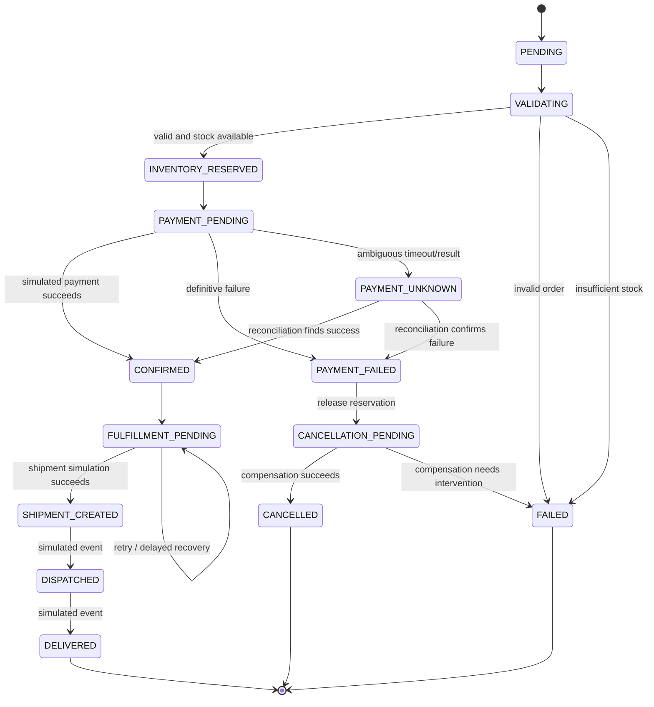

# Order State Machine and Saga Compensation

## 1. State machine overview



This is a logical status model. The actual Step Functions ASL definition must use valid service states and explicit `Retry`, `Catch`, `TimeoutSeconds`, `ResultPath`/payload handling, and task inputs/outputs.

## 2. Suggested workflow

1. `ValidateOrder`
2. `ReserveInventory`
3. `SimulatePayment`
4. `ConfirmOrder`
5. `PublishOrderEvent` or durable event/outbox step
6. `InitiateShipment`
7. `MarkFulfillmentState`
8. `Success`

Failure branches:
- Validation failure: mark rejected/failed; no reservation exists.
- Insufficient stock: mark rejected; do not attempt payment.
- Definitive payment failure: execute `ReleaseInventory` compensation, then mark cancelled/failed.
- Ambiguous payment: `ReconcilePayment`; do not immediately release inventory or blindly retry payment.
- Shipment initiation failure after successful payment: bounded retry and then `FULFILLMENT_PENDING`/manual intervention. Do not auto-refund unless a defined cancellation policy requires it.
- Compensation failure: record a high-severity event/metric and expose it for operator attention. Do not claim rollback succeeded if it did not.

## 3. Saga principles

A saga is a sequence of local transactions with compensating actions; it is not a global database rollback.

| Forward action | Possible compensation |
|---|---|
| Reserve inventory | Release the exact active reservation |
| Simulate payment success | Record simulated reversal/refund if cancellation policy requires it |
| Confirm order | Mark cancellation/exception state; preserve audit history |
| Create shipment | Cancel simulated shipment if supported and not already dispatched |

Compensation itself can fail and must be retryable, idempotent, observable, and safe to repeat.

## 4. Idempotency contract

Each side-effecting task receives:
- `orderId`
- stable operation/reservation/payment attempt ID
- `correlationId`
- schema/version identifier

Before performing a side effect, check durable state and use conditional writes so duplicate task invocations return the existing result instead of repeating the effect.

Do not use a newly generated random key on every retry. The operation key must remain stable across retries for the same logical operation.

## 5. Inventory reservation example

Use an atomic conditional update, not read-then-write:
- Condition: available stock is at least the requested quantity.
- Update: decrement available and increment reserved.
- Record reservation ID and active status with a safe idempotency strategy.
- On compensation, condition on that reservation still being active; release exactly once.
- On successful fulfillment, transition the reservation to committed/consumed according to the selected inventory accounting model.

For multi-item orders, document how partial reservation is avoided or compensated. If reserving items individually, release all earlier successful reservations if a later item cannot be reserved.

## 6. Payment ambiguity

A timeout does not prove that payment failed. The payment simulator should support an `UNKNOWN` outcome in tests. Reconcile using the same stable attempt ID. In a real payment provider integration, query provider status before retrying a potentially successful charge.

## 7. Workflow inputs and outputs

Minimal execution input:
```json
{
  "schemaVersion": "1",
  "orderId": "ord_example",
  "customerId": "user_example",
  "correlationId": "corr_example"
}
```

Avoid passing unnecessary personal information or full untrusted checkout bodies through every workflow state. Fetch authoritative order data from storage when needed.

## 8. Required tests

- Happy path.
- Invalid order.
- Insufficient stock.
- Payment definitive failure and inventory release.
- Payment ambiguous, reconciliation success.
- Payment ambiguous, reconciliation failure.
- Lambda failure before and after durable write.
- Duplicate task execution.
- Multi-item partial reservation and compensation.
- Shipment failure after payment success.
- Compensation failure and alert.
- Workflow start failure after order persistence.
